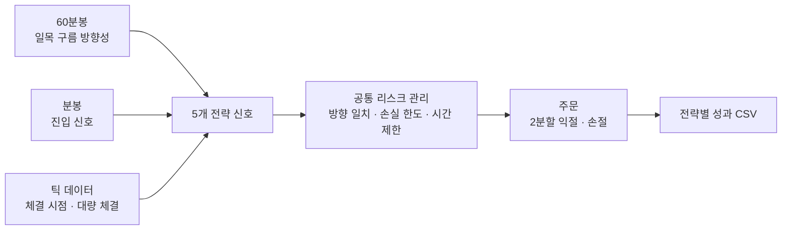

# MNQ Ichimoku · Bollinger 복합 전략

**QVSD 퀀트 트레이딩 대회 우승** · 2026.05.15 · 주최 그라인딩 라이프, LifeUp, NinjaTrader

마이크로 나스닥100 선물(MNQ)을 대상으로, 성격이 다른 5개의 단기 전략을 하나의 시스템으로 묶은 자동매매 전략입니다. NinjaTrader 8(C#, NinjaScript)으로 구현했습니다.

## 설계 아이디어

하나의 지표에 의존하는 전략은 시장 국면(추세장·횡보장)이 바뀌면 성과가 크게 흔들립니다. 그래서 **추세 추종(일목균형표), 평균회귀(볼린저 밴드), 수급 추종(대량 체결)** 처럼 서로 다른 국면에서 수익을 내는 전략을 함께 운용하고, 공통 리스크 관리 계층에서 전체 포지션을 통제하도록 설계했습니다.



## 데이터 구조 (멀티 타임프레임)

| 시간 단위 | 역할 |
|---|---|
| 60분봉 | 직전 봉의 시가·고가가 일목 선행스팬 B 위면 상승, 아래면 하락 바이어스 |
| 분봉 (주 차트) | 일목·볼린저·MACD 진입 신호 판단 |
| 1틱 | 실시간 체결가로 진입 시점 포착, 대량 체결 감지 |

## 5개 전략

| 전략 | 유형 | 진입 조건 요약 |
|---|---|---|
| **Ichimoku Touch** | 추세 눌림목 (롱) | 상승 구름 위에서 13개 봉 연속 유지 후 가격이 선행스팬 A에 닿을 때. MACD가 상승 쪽에 있거나 60분봉이 상승 바이어스일 때만 |
| **Ichimoku Breakout** | 추세 돌파 | MACD가 일정 기간 한쪽에 머물다 반대로 교차하고, 종가가 구름 돌파 위치에 있을 때. 60분봉 바이어스 필요 |
| **BB Cross** | 모멘텀 | MACD 0선 교차와 볼린저 중심선 부근 마감이 겹칠 때. 구름 반대편이면 바로 진입하지 않고 5~15봉 뒤 재확인 후 진입 |
| **BB Reversion** | 평균회귀 | 꼬리가 볼린저 밴드를 뚫고 몸통은 밴드 안으로 돌아올 때. 60분봉 바이어스와 같은 방향만, 구름 안에서는 진입하지 않음 |
| **Big Trade Follower** | 수급 추종 | 한 틱에 90계약 이상 대량 체결 발생 시 그 방향으로 진입. EMA(21)·세션 VWAP·ADX(14) ≥ 18 필터 통과 시에만 |

## 리스크 관리

**주문 단위**
- 모든 진입은 2개 레그로 나누어, 절반은 1R, 나머지는 2R에서 익절합니다 (R = 손절폭).
- 손절폭은 최근 10개 봉 평균 변동폭에 연동합니다. Big Trade는 ATR(14) × 1.2로 정하되 90~160틱 범위로 제한합니다.
- Big Trade는 1차 익절 후 남은 물량의 손절가를 본전 +2틱으로 올립니다.

**전략 단위**
- 볼린저 계열 전략은 하루 연속 3회 손실 시 45분간 신규 진입을 막습니다.
- Big Trade는 세션당 3회 손실 시 당일 거래를 멈춥니다.
- 손절 직후에는 쿨다운을 두고, 조건이 다시 맞을 때만 재진입합니다.

**포트폴리오 단위**
- 전략은 각각 한 번에 하나의 포지션만 가지며, 롱과 숏을 동시에 보유하지 않습니다.
- 거래 시간은 08:00~12:00로 제한하고, 12:00에 모든 포지션을 청산합니다.
- 정규장 개장(09:30) 5분 전에 포지션을 정리해 개장 직후 급변동을 피합니다.
- 진입 후 15분이 지나면 시간 청산합니다 (Big Trade 제외).

## 성과 기록

실행이 끝나면 NinjaTrader 사용자 폴더의 `strategy_exports/`에 두 파일이 자동 생성됩니다.

- `*_trades.csv`: 거래별 진입·청산 시각, 전략, 방향, 수량, 손익, 청산 사유
- `*_summary.csv`: 전략별 거래 수, 승률, 총이익·총손실, 순손익, Profit Factor

전략별로 성과를 나누어 기록해, 어떤 전략이 수익을 내고 어떤 전략이 손실을 키우는지 바로 비교할 수 있게 했습니다.

## 실행 방법

1. NinjaTrader 8에서 `New → NinjaScript Editor`를 엽니다.
2. `Strategies` 폴더에 `MNQ_IchimokuBbCompositebacktest.cs`를 추가하고 컴파일(F5)합니다.
3. Strategy Analyzer에서 MNQ 분봉 차트를 선택하고 `MNQ_IchimokuBbCompositebacktest`로 백테스트합니다.

주요 파라미터(전략별 on/off, 수량, 손절 배수, 손실 한도, 거래 시간 등)는 모두 전략 속성 창에서 조정할 수 있습니다.

## 파일 구성

```
├── README.md
└── MNQ_IchimokuBbCompositebacktest.cs   # 전략 전체 코드 (약 2,700줄)
```

---

본 저장소는 대회 참가 결과를 기록한 포트폴리오이며, 투자 권유가 아닙니다.
